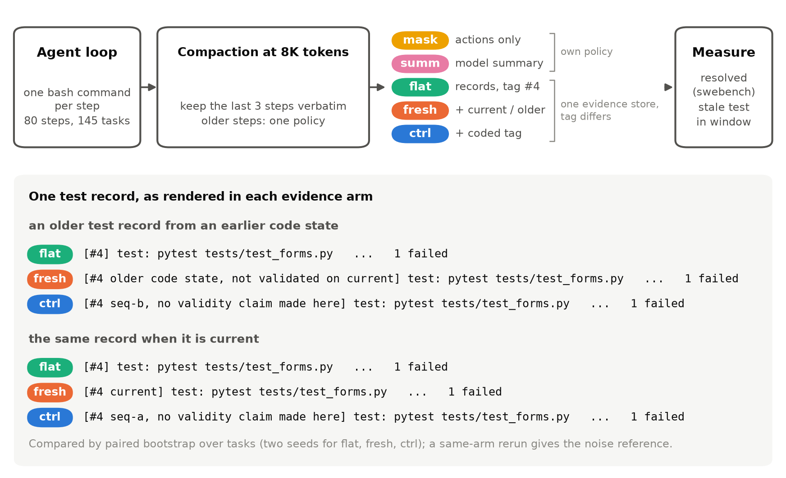
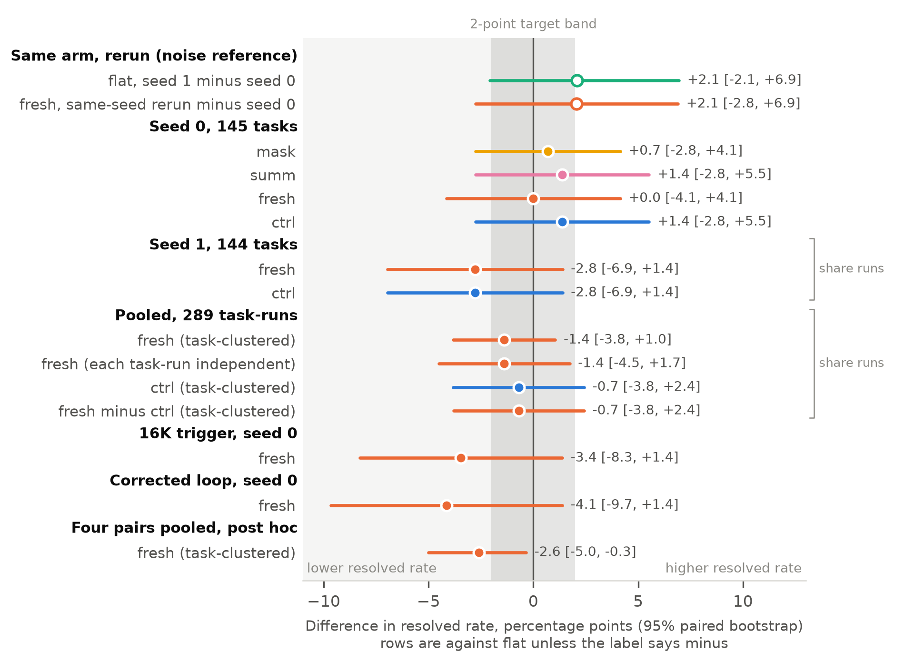
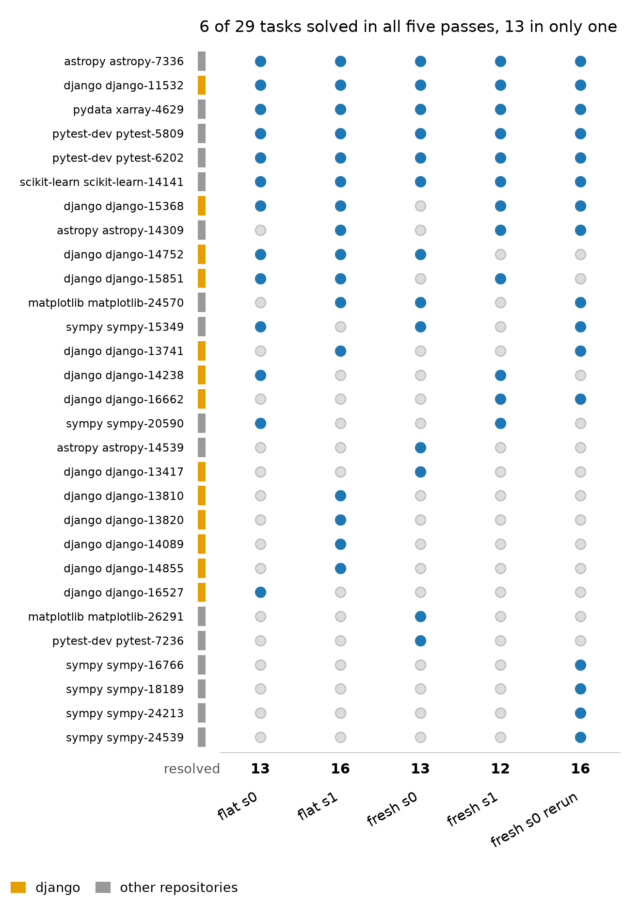
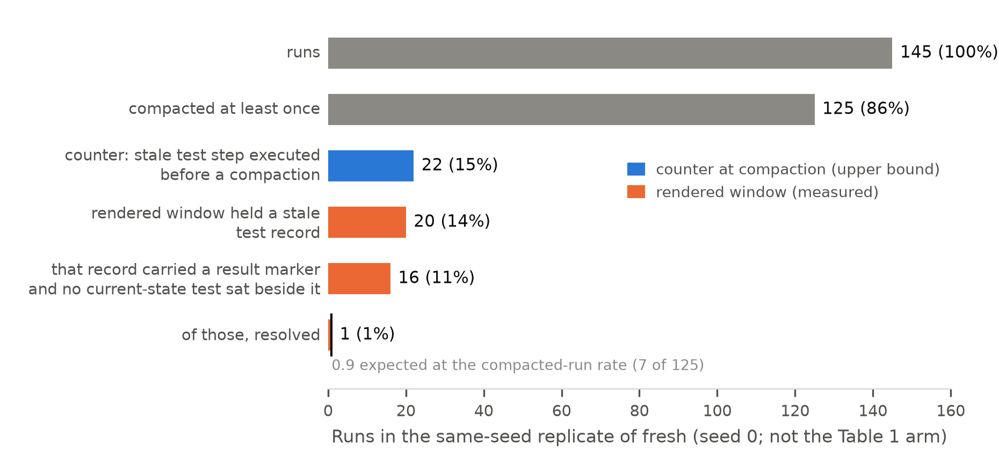
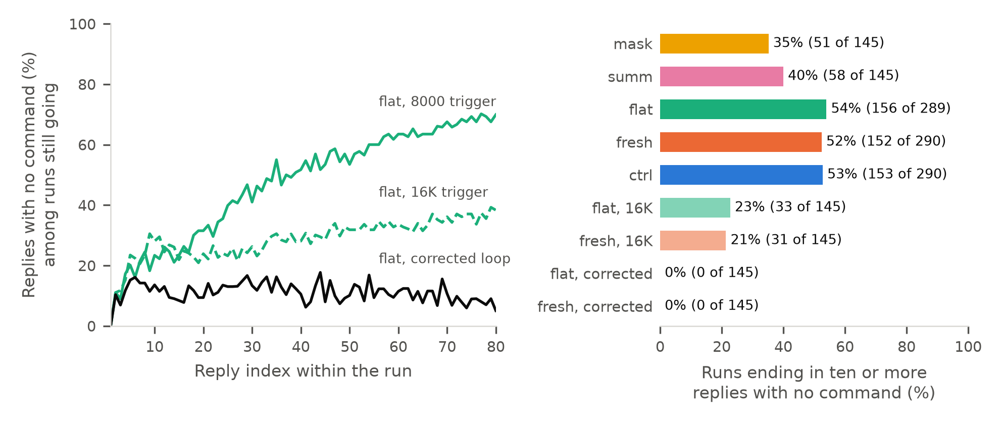

# Freshness tags on stale test evidence at compaction: no detectable benefit, a run-to-run noise floor and a one-line loop fix for a Gemma 4 12B agent

Hailey H. L. Cheng, Columbia University. November 2026. Submission topic: Tasks and Benchmarks.

## Abstract

Does telling a 4-bit Gemma 4 12B coding agent that a retained test result is stale change how many SWE-bench Verified tasks it resolves? We ran five memory policies on 145 held-out tasks with compaction triggered at 8000 tokens, under a seed-0 protocol frozen in advance: two simplified published baselines (mask, summ), flat (evidence records with sequence numbers), fresh (the same records with a current-or-stale tag) and ctrl (a coded tag). The frozen comparison found no detectable difference: fresh and flat each resolve 13 of 145 tasks. Pooled with a second seed added afterwards, fresh is -1.4 points against flat ([-3.8, +1.0] task-clustered, [-4.5, +1.7] unclustered). Three results matter beyond the tag. First, noise: adding the tag changes 10 task outcomes per seed and rerunning one configuration changes 11 to 13, so a 2-point effect at 80 percent power needs about 1700 independent task pairs. Second, exposure: a stale test result sat in the model's window in 16 and 27 of 145 runs of two logged fresh passes, and half of all resolutions occur in runs that never compacted. Third, a loop fault: 46 percent of replies carry no command and half of all runs end in ten or more of them in a row. A post hoc diagnostic shows mostly one word repeated to the reply limit and fed back by the loop. Replacing such replies with a placeholder removed every such ending in flat and fresh; flat then resolved 19 of 145 and fresh 13 (-4.1 points [-9.7, +1.4]). Post hoc pooling of four pairs puts fresh 2.6 points behind ([-5.0, -0.3]; by-task sign test p = 0.12), unadjusted: a hypothesis, not a finding. For builders: read the replies with no command, measure exposure before designing a memory policy, and do not rank policies on one seed.

## Introduction

Small-model coding agents run out of context, so the loop must decide what old output to keep (compaction). A test result recorded before an edit says little about the current code. We test whether labelling a retained test result as stale helps a 4-bit Gemma 4 12B (Google DeepMind, 2026) in a bash-only loop: five memory policies on SWE-bench Verified, three of which differ only in the tag. We contribute four things: how often stale test evidence is present at compaction, a run-to-run noise reference for a 12B agent at a 9 percent resolved rate, the action log of every run, and a loop fault that stalled half the runs, with its fix.

In two pilots on 23 dev tasks, tests ran in 25 of 1188 executed steps, and a gate set before pilot 2 failed: 1 of 21 tasks retained a stale test record at a compaction, against 8 required.

## Related work

Compaction policies. Lindenbauer et al. (2025) found observation masking matching model summarisation's solve rate for SWE-agent on SWE-bench Verified at about half the raw agent's cost; both are our baselines. Salle et al. (2026) find no strategy beating default self-summarisation on long-horizon benchmarks, and CORVUS (Zheng et al., 2026) swaps stale file snapshots for current contents. These policies drop, summarise or replace stale evidence; none labels it.

Stale evidence and its labelling. Closest is Gao et al. (2026): on frozen programs with Qwen2.5-14B, a failure trace from an earlier code state, presented as if current, harmed 34 of 135 correct starts against 4 of 135 for a current trace. The stale trace carried no label; whether labelling helps is untested. EA-Graph (Hsu et al., 2026), Assay (Tiwari et al., 2026) and Tether (Wang et al., 2026) bind verification claims to code versions or withdraw them; none is reported to show the model a label.

Testing and noise. Miller (2024) and Madaan et al. (2024) put error bars on static benchmark scores; agent evaluations add run-to-run variation. Bjarnason et al. (2026) find single-run pass@1 on SWE-bench Verified varying by 2.2 to 6.0 points between runs; by their power analysis, detecting a 2-point effect needs about nine runs.

## Methods: agent loop and memory policies

Figure 1. Study design: the agent loop, compaction at 8000 tokens through one of five memory policies, the two measurements, and one older test record as each evidence arm renders it.

Figure 1 summarises the design. Our loop adapts mini-SWE-agent (Yang et al., 2024). The model sees the issue and replies with a thought and one bash command, run in the task's SWE-bench image with a 180 second timeout; the output returns clipped to its first and last 2000 characters. The system prompt, identical across arms, asks the agent to run the relevant existing tests after each edit and not to modify them; the run ends when the agent's command contains a fixed submit string, and we grade the git diff. A reply with no complete bash block runs nothing but counts as a step, returns to the model as its own turn and is compacted like one. Tests, gold patches and hints never enter the context. The prompt never explains the tags below, and we have no check that the model attends to them.

Compaction runs at every step whose previous prompt exceeded 8000 tokens; the last three steps stay verbatim and older steps go through the arm's policy.

Each executed step is an edit if the workspace fingerprint (a hash of the git diff and untracked files after every command) changed, a test if the command contains pytest, runtests, unittest, manage.py test, tox or nosetests and the fingerprint did not change, and otherwise a read. A command that edits and tests at once counts as an edit and a reproduction script run with python as a read.

Mask keeps only the commands of the 40 most recent older steps; summ asks Gemma for one running summary under 300 words.

The other three arms share one evidence store. Each older step becomes a record (kind, command, the first 500 characters of output, the last 900 for tests) rendered with a bracketed tag in a window of the last 9000 rendered characters, so the oldest records drop first.

The three arms differ only in the tag. Flat uses a sequence number such as #4. Fresh adds "current" when the record's fingerprint matches the workspace and "older code state, not validated on current" when it does not. Ctrl adds "seq-a," or "seq-b," followed by "no validity claim made here", with seq-a on the records fresh would call current. Ctrl is not a null tag: it nears fresh's tag length only on stale records, mentions validity and encodes the same current-or-stale split. So fresh against ctrl compares the wording, and ctrl against flat adds text and a coded tag.

## Experimental protocol

We froze the seed-0 protocol on 8 November 2026, before reading any held-out outcome. The model is google/gemma-4-12B-it-qat-w4a16-ct at revision 1d2c2d7f, served by vLLM 0.33.0 (Kwon et al., 2023) on A100-80GB GPUs with a 32768-token context, thinking off in the chat template, temperature 0.3, the run's seed as the request seed, and at most 1200 tokens per reply. Runs stop at an 80-step limit and averaged 69 steps and 50 minutes.

The held-out set has 145 SWE-bench Verified tasks (Jimenez et al., 2024; Chowdhury et al., 2024) stratified across 10 repository groups. Each task runs once per arm with seed 0. A second pass with seed 1 reruns flat, fresh and ctrl (the trio); its flat arm lacks one pylint-dev task, so seed-1 statistics use the 144 tasks in all three arms.

We grade with the swebench 4.1.0 evaluation script. Step-limit runs are graded on their diff at the limit. A gold-patch preflight on the held-out tasks (Amendment 3) resolves 142 of 145; the frozen text excludes the other three, but no arm resolves them, so we keep them: no count changes and the primary interval moves 0.1 points.

The primary comparison, fresh against flat, uses paired differences in the resolved flag, with 95 percent percentile-bootstrap intervals over tasks (5000 resamples, random seed 1). Sign tests are two-sided.

At each compaction the exposure counter counts the test steps whose fingerprint differs from the current one; a stale test record is retained when that count is positive. The counter includes records outside the window and outputs without a result marker, so it is an upper bound for pattern-matched tests and silent on python-script verification.

Infrastructure errors were rerun (Amendments 1 and 2).

Deviations. The frozen protocol covered seed 0 of five arms. Seed 1 of the trio and the pooled estimate were decided after the seed-0 table was read; the 16K-trigger arm, the gold-patch preflight and a same-seed replicate of fresh after the seed-1 table. Amendment 3 records the seed-1 additions after the fact and the 16K arm, preflight and replicate before any of their outcomes was read. After the freeze we read partial seed-0 results while it ran. Everything else reported is exploratory.

Released materials. Code, manifests, protocol, results/, figures, logs/actions/*.jsonl.gz (every run's actions, step kinds, token counts and compaction events; no tool outputs or raw replies) and logs/diag (the diagnostic's per-reply records) are at github.com/heilcheng/gemma4-compaction-audit, tag v1.0.

## Results

Table 1 gives the seed-0 matrix and Figure 2 every comparison with the rerun differences. Only fresh against flat was frozen in advance. Every arm resolves 13 to 15 of 145 tasks and every interval against flat covers zero.

| Arm | n | Resolved | Rate | vs flat, 95% CI | Wins/losses | Step limit | Compacted | Stale test retained |
|---|---|---|---|---|---|---|---|---|
| mask | 145 | 14 | 9.7% | +0.7 [-2.8, +4.1] | 4/3 | 112 | 131 | 24 |
| summ | 145 | 15 | 10.3% | +1.4 [-2.8, +5.5] | 6/4 | 114 | 126 | 26 |
| flat | 145 | 13 | 9.0% | reference | | 113 | 126 | 25 |
| fresh | 145 | 13 | 9.0% | 0.0 [-4.1, +4.1] | 5/5 | 114 | 135 | 32 |
| ctrl | 145 | 15 | 10.3% | +1.4 [-2.8, +5.5] | 6/4 | 112 | 124 | 23 |

Table 1. Seed 0, 145 held-out tasks; differences in percentage points. Wins/losses: tasks resolved only by the arm or only by flat. Stale test retained: runs where the counter retained a stale test record, an upper bound on what the rendered window held.

Figure 2. Resolved-rate differences in percentage points with 95% paired bootstrap intervals. Hollow markers: the noise reference, one arm rerun with a new seed (flat) or the same seed (fresh). Filled markers: arms against flat in seed 0 (all four), in seed 1 and both seeds pooled (fresh and ctrl, task-clustered; fresh also with each task-run independent), at the 16K trigger and under the corrected loop (fresh); one row is fresh minus ctrl. Seed-1 and pooled rows share runs, and some coincide exactly. Only the seed-0 fresh row was frozen in advance; the bottom row is the post hoc pooling of the four fresh and flat pairs. Grey band: plus or minus 2 points, the target effect.

Seed 1 repeats the trio on 144 tasks: flat resolves 16, fresh 12 and ctrl 12, so fresh against flat is -2.8 points [-6.9, +1.4]. Pooled over 289 task-runs, flat resolves 29, fresh 25 and ctrl 27. Fresh against flat is -1.4 points, [-3.8, +1.0] task-clustered and [-4.5, +1.7] with each task-run independent. Fresh against ctrl and ctrl against flat are both -0.7 [-3.8, +2.4]. A stale test record was retained at a compaction in 18 percent of task-runs and a stale read in three fifths to two thirds; among the 18 percent, fresh resolved 6 of 57 and flat 5 of 49.

Rerunning flat with a new seed changed 11 of 144 task outcomes; swapping flat for fresh changed 10 of 145 in seed 0 and 10 of 144 in seed 1. In 11 of those 20 flips the fresh run retained no stale test record; over half the tag flips cannot be the tag acting on test evidence. The same-seed replicate of fresh resolved 16 of 145 against 13 originally and changed 13 tasks; only 67 of 145 runs repeated the original's first three actions, so a seed did not reproduce a run. The flat rerun and the fresh replicate each resolved 3 more tasks than the original, +2.1 points (Figure 2, hollow markers). Figure 3 shows which of five passes (flat and fresh at both seeds, plus the fresh replicate) resolved each of the 29 tasks solved at least once: 6 were solved by all five and 13 by only one.

Figure 3. Every task resolved by at least one of five passes: flat and fresh at seed 0 (s0) and seed 1 (s1), and the same-seed rerun of fresh. Filled dots mark the passes that resolved the task; the left bar marks django tasks (orange) against other repositories (grey); the bottom row gives each pass's resolved count.

Consequence for benchmarking. Between two passes of the same arm, 8.5 percent of tasks change outcome (37 of 434 pairs). On a 120-task benchmark, two passes of one configuration differ in resolved rate with a standard deviation of 2.5 to 2.7 points, so a 5-point or larger gap arises by chance about one time in twelve. A paired comparison with our 289 task-runs has at most 22 percent power to detect a 2-point difference (sign test); 80 percent power needs about 1700 independent task pairs.

Where resolutions happen. Of the 1159 matrix runs, 124 never compacted and 55 of those resolved; the 1035 that compacted resolved 55, so half of all resolutions occur where no memory policy acts. Of 972 runs past step 40, 7 later submitted a resolving patch and 25 resolved on the diff at the step limit: 2 to 4 percent in every arm.

Window logging in the replicate (Figure 4) shows the counter's overstatement: it retains a stale test record in 22 of 145 runs, the rendered window held one at a compaction in 20, and one with a result marker in 16, each at some step with no current-state test beside it. A stale test result to discount is rare. One of the 16 resolved, against 0.9 expected at the compacted-run rate (7 of 125).

Figure 4. Exposure in the same-seed replicate of fresh (145 runs; not the Table 1 arm, whose counter flagged 32): runs that compacted, runs the counter flagged (blue, an upper bound), runs whose rendered window held a stale test record and then one with a result marker and no current-state test beside it (orange, logged at run time with tag length approximated), and the one of those that resolved; the tick marks the 0.9 expected at the compacted-run rate (7 of 125).

Post hoc, fresh trails in django (8 against 15 of 130 task-runs; ctrl 9) and not elsewhere (17 against 14); two splits examined, no interaction test. In the 16K-trigger arm at seed 0 (compaction in 93 and 99 of 145 runs), flat resolves 16 against fresh 11, -3.4 points [-8.3, +1.4].

Replies with no command. 46 percent of the 80083 replies held no complete command and averaged 1200 completion tokens, the reply limit (3 percent in never-compacted runs, 48 in compacted). 570 of 1159 runs end with ten or more such replies in a row, a stall, and 13 of those resolved against 97 of the other 589. Stall rates differed by arm (Figure 5): 35 percent of mask runs and 40 of summ (seed 0), 52 to 54 of flat, fresh and ctrl (both seeds), and 21 to 23 at the 16K trigger. In seed 0, 36 tasks stalled only under flat and 14 only under mask (sign test p = 0.003).

Figure 5. Replies with no command. Left: their share at each reply index among runs still going, for seed-0 flat at the 8000 and 16K triggers and under the corrected loop (145 runs each). Right: runs ending in ten or more of them, by arm (seeds pooled at the 8000 trigger; seed 0 at 16K and for the two corrected-loop passes). Onset is confounded with run length and compaction.

A post hoc diagnostic (Amendment 4, written before its runs) reran flat on 40 held-out tasks with every reply logged. All 1303 replies with no command ended at the reply limit: 1235 were almost entirely the word "thought" repeated and 68 were commands cut off. With thinking off, the chat template opens the model's turn with an empty thought channel. Our untested reading is that the model echoes that word and the loop hands it back as the model's own turn; plain repetition degeneration would look the same. Replacing that text with a one-line placeholder (the corrected loop, a variant chosen after reading the replies; it also shortens later prompts) left none of the 40 runs stalled (23 before), cut these replies from 44 to 11 percent and resolved 5 tasks against 6. We ran all 145 tasks, a step decided after the 40-task result. No run stalled (73 in seed-0 flat), 99 hit the step limit (113), the median was 70 commands against 31, and 19 tasks resolved against 13: +4.1 points [-0.7, +9.0], 10 gained and 4 lost (sign test p = 0.18).

Fresh under the corrected loop (Amendment 5, written after the flat pass and before this run) stalled in no run (77 in seed-0 fresh) but resolved 13 tasks. Against corrected flat it is -4.1 points [-9.7, +1.4], 5 gained and 11 lost (sign test p = 0.21). The counter retained a stale test record in 27 flat and 34 fresh runs, and the window held one with a result marker in 21 and 27. None of those 27 fresh runs resolved (1.5 expected at that pass's compacted-run rate, P(0) about 0.2; 3 of the 21 flat runs did), yet in 12 of the 16 tasks where the arms differ the fresh run retained no stale test record.

After that result we pooled the four flat and fresh pairs (seed 0, seed 1, 16K, corrected loop), outside any amendment. Fresh tied once and trailed three times (0, -4, -5, -6 tasks), resolving 49 of 579 task-runs against 64: -2.6 points, task-clustered [-5.0, -0.3], unadjusted. Leaving out any one pair, three of the four intervals include zero. By task, 9 favour fresh on net and 18 flat (sign test p = 0.12). The deficit is in django (fresh 12, flat 28 of 260 task-runs; elsewhere 37 against 36 of 319), again post hoc. The pairs differ in trigger and loop, and ctrl ran in two, so we cannot separate the wording from added tag text.

## Limitations

We use one checkpoint, one agent loop and one primary trigger, so the findings may not carry to other Gemma sizes or to the Kaggle competition's own scaffold. Only flat and fresh ran under the corrected loop, once each, so flat's gain, absent in fresh, may be noise. The four-pair deficit of fresh is post hoc and unadjusted; calling it a cost needs a preregistered rerun. With no raw-history arm, we cannot say whether compacting at 8000 of 32768 tokens helps. The tag labels stale reads, present in most runs; we did not isolate their effect. Stale test evidence is present in under a quarter of task-runs; the two-seed interval covers all runs, so it cannot exclude the tag erasing most resolutions among those.

The fingerprint counts any file change as a new state, so one edit marks older records stale and the tag may discriminate little. The result-marker pattern matches error and words ending in ok, so some flagged windows may hold no test verdict. SWE-bench Verified may overlap with the model's training data.

## Conclusion

The freshness tag showed no detectable benefit. Rerunning an arm changed 11 to 13 of about 145 task outcomes, at least as many as swapping the tag (10), so one-seed memory comparisons for a 12B agent at this resolved rate cannot be told from noise. The tag had a stale test result to act on in 16 and 27 of 145 runs of two logged fresh passes, and over half its flips held none. Half of all resolutions occur in runs that never compacted; runs past step 40 resolved 2 to 4 percent under every policy. Half of all runs ended stalled, at rates differing by arm; the diagnostic linked the stall to one repeated word fed back, and a post hoc one-line change removed it in both arms rerun, raising flat's count (interval covers zero) but not fresh's. Fresh never led flat in four pairs; pooled, it trails by 2.6 points, post hoc and unadjusted: a hypothesis for a preregistered rerun, not a finding. For builders: read the replies with no command, measure how often a policy's target evidence is present, then compare policies over several seeds.

Use of AI tools: language models drafted code and text under our direction; we checked every number against the saved run records (202 of them recompute from the public release) or the cited papers and take responsibility for the content.

## References

Bjarnason, B. H., Silva, A. and Monperrus, M. (2026). On Randomness in Agentic Evals. arXiv:2602.07150.

Chowdhury, N., Aung, J., Shern, C. J., Jaffe, O., Sherburn, D., Starace, G., Mays, E., Dias, R., Aljubeh, M., Glaese, M., Jimenez, C. E., Yang, J., Ho, L., Patwardhan, T., Liu, K. and Madry, A. (2024). Introducing SWE-bench Verified. OpenAI, August 2024. Dataset princeton-nlp/SWE-bench_Verified.

Gao, X., Yang, J. and Yang, Q. (2026). Looping Is Not Reliability: State-Bound Evidence and Typed Revision Contracts for Agentic Code Repair. AgenticDev 2026. arXiv:2607.24604.

Google DeepMind (2026). Gemma 4 model card and weights, google/gemma-4-12B-it-qat-w4a16-ct, revision 1d2c2d7f, Hugging Face.

Hsu, H.-J., Chi, C.-J. and Everett, H. (2026). EA-Graph: Artifact-Anchored Verification Memory for Coding Agents under Upstream Drift. arXiv:2608.04278.

Jimenez, C. E., Yang, J., Wettig, A., Yao, S., Pei, K., Press, O. and Narasimhan, K. (2024). SWE-bench: Can Language Models Resolve Real-World GitHub Issues? ICLR 2024. arXiv:2310.06770.

Kwon, W., Li, Z., Zhuang, S., Sheng, Y., Zheng, L., Yu, C. H., Gonzalez, J. E., Zhang, H. and Stoica, I. (2023). Efficient Memory Management for Large Language Model Serving with PagedAttention. SOSP 2023. arXiv:2309.06180.

Lindenbauer, T., Slinko, I., Felder, L., Bogomolov, E. and Zharov, Y. (2025). The Complexity Trap: Simple Observation Masking Is as Efficient as LLM Summarization for Agent Context Management. DL4C workshop at NeurIPS 2025. arXiv:2508.21433.

Madaan, L., Singh, A. K., Schaeffer, R., Poulton, A., Koyejo, S., Stenetorp, P., Narang, S. and Hupkes, D. (2024). Quantifying Variance in Evaluation Benchmarks. arXiv:2406.10229.

Miller, E. (2024). Adding Error Bars to Evals: A Statistical Approach to Language Model Evaluations. arXiv:2411.00640.

Salle, J., Bhatnagar, H., Bethge, M., Abdelnabi, S. and Andriushchenko, M. (2026). Benchmarks Are Surprisingly Compaction-Friendly. arXiv:2610.31778.

Tiwari, O. S., Vass, T. and Singh, G. D. (2026). Assay: Claims That Decay With the Code. Content-Addressed Evidence Graphs for Accountable AI-Assisted Software Delivery. arXiv:2609.36170.

Wang, Y., Ju, J., Zhang, J., Wu, Z., Duan, Y., Sun, Z., Cai, T. and Zheng, M. (2026). Memories That Outlive Their Reasons: Dependency-Tethered Memory for Tool-Using LLM Agents. arXiv:2610.25123.

Yang, J., Jimenez, C. E., Wettig, A., Lieret, K., Yao, S., Narasimhan, K. and Press, O. (2024). SWE-agent: Agent-Computer Interfaces Enable Automated Software Engineering. NeurIPS 2024. arXiv:2405.15793. mini-SWE-agent is the authors' reduced bash-only loop (github.com/SWE-agent/mini-swe-agent).

Zheng, M., O'Brien, D., Cui, S., Pashakhanloo, P., Mukherjee, R., Kim, M. and Kuhar, S. (2026). CORVUS: Context Optimization and Reduction Via Underlying Synchronization for LLM Coding Agents. arXiv:2607.22711.

## Project links

Code, protocol, results and action logs: https://github.com/heilcheng/gemma4-compaction-audit (tag v1.0). PDF: https://github.com/heilcheng/gemma4-compaction-audit/blob/v1.0/paper/latex/main.pdf.
